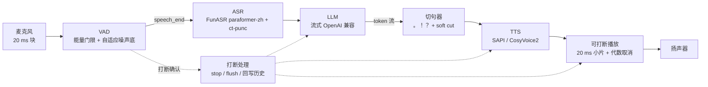

# 全双工语音 Agent · Full-Duplex Voice Agent

**一条从麦克风到扬声器的实时语音对话链路：VAD → ASR → LLM → TTS，随时可以被打断，每一毫秒都可追踪。**


不依赖 pipecat / LiveKit —— 整条管线（采集、判停、转写、生成、合成、可打断播放、埋点、报表）
是自己写的约 2,600 行 Python，**每一处延迟都能对应到一行代码**。同时提供纯 mock 模式：
没有 GPU、没有麦克风、没有 API key 的机器上也能把全链路跑通并产出真实的时间戳。

---

## 实测数据

真机环境：Windows 11 + RTX 5060 Laptop **8 GB**，3 轮连续对话（含 3 次用户打断）。

| 指标 | 含义 | 实测 | 预算 | 结论 |
| --- | --- | ---: | ---: | :-- |
| `asr_latency` | 判停 → 转写完成 | **87 ms** | 300 ms | ✅ |
| `llm_ttft` | 请求发出 → 首个 token | **759 ms** | 400 ms | ❌ 超预算 |
| `tts_latency` | 首句 → 首帧音频 | **121 ms** | 300 ms | ✅ |
| `e2e_first_audio` | 判停 → 首帧音频真正出声 | **967 ms** | 800 ms | ❌ 超预算 |
| `barge_in_stop` | 检测到插话 → 声音真的停止 | **12 ms** | 250 ms | ✅ |
| `bot_speech_dur` | 单轮播报时长 | 2 109 ms | – | 参考 |

`e2e` 没进 800 ms，原因已经用对照实验定位：**时间几乎全在 LLM 的首个 token 上**（759 ms），
其余环节加起来约 200 ms。把 TTS 从 pyttsx3 的「每句起一个进程」改成常驻 SAPI COM 实例后，
首帧合成从 430 ms 降到 121 ms —— 这部分是我能控的，已经压到位；剩下那段是服务端排队与网络，
要换自建推理或本地量化模型才能继续压。

同一条链路在 mock 模式（模型全假、音源脚本化）下的基线见「快速开始」里的那张表：
`e2e 279 ms`、`barge_in_stop 11 ms`。mock 数字用于验证**管线自身开销**，不代表真实模型性能。

---

## 核心特性

- **全双工可打断**：用户一开口，播放队列立刻清空（实测 12 ms 停止），并只把「用户真正听到的那部分回答」写回对话历史。
- **九事件埋点 → 六指标报表**：每次运行落一份 `events.jsonl`，退出自动打印 P50 / P90 与预算对比表。
- **20 ms 分块音频**（16 kHz × 20 ms = 320 采样点）：打断响应、状态切换、播放进度都建立在这个粒度上。
- **三级降级**：ASR / LLM / TTS 每个后端都能退回 mock 或静音实现，缺任何一环都不会崩。
- **零依赖配置**：内置 `src/miniyaml.py`（YAML 子集解析器），装不上 PyYAML 也能读 `config.yaml`。
- **配套文档**：架构与数据流、逐函数代码导读、排错与调参。

---

## 架构



三个线程各管一件事：

| 线程 | 职责 | 关键文件 |
| --- | --- | --- |
| 主线程 | 读麦克风、喂 VAD、驱动轮次状态机 | `src/agent.py` |
| 播放线程 | 从队列取音频，按 20 ms 小片写声卡，逐片检查是否被打断 | `src/audio_io.py` |
| 回答线程 | 一轮对话：ASR → LLM 流式 → 切句 → 逐句 TTS | `src/agent.py` |

---

## 快速开始

```bash
git clone https://github.com/ShenShermy/full-duplex-voice-agent.git
cd full-duplex-voice-agent
pip install -r requirements-core.txt      # 只有 numpy + PyYAML（没有 PyYAML 也能跑）
python run.py --backend mock              # 无模型、无麦克风、无 GPU，直接跑通全链路
```

退出时会打印这张表（下面是一次真实的 mock 运行，`--max-turns 3`，数值随机器与负载浮动）：

```
| 指标 | 说明 | n | 均值 | P50 | P90 | 预算 | 结论 |
| asr_latency     | 判停→最终转写        | 3 | 116 ms | 114 ms | 123 ms | 300 ms | 达标 |
| llm_ttft        | 转写→首个 token      | 3 |  16 ms |  16 ms |  17 ms | 400 ms | 达标 |
| tts_latency     | 首 token→首帧音频    | 3 | 147 ms | 130 ms | 183 ms | 300 ms | 达标 |
| e2e_first_audio | 判停→首帧音频        | 3 | 279 ms | 256 ms | 312 ms | 800 ms | 达标 |
| barge_in_stop   | 打断检测→音频真停止  | 2 |  11 ms |  11 ms |  17 ms | 250 ms | 达标 |

- 轮次数：3；成功测到打断的轮次：2（67%）
- 超预算指标：无
```

注意 `e2e` 不是各段之和：判停之后还有句子切分与 TTS 起播的开销，
这些零碎时间只有端到端那一条时间戳能覆盖住。

### 三种跑法

| 模式 | 命令 | 额外需要 | 用途 |
| --- | --- | --- | --- |
| 纯模拟 | `python run.py --backend mock` | 无 | 验证逻辑、测管线开销、演示 |
| 真麦克风 + 假模型 | `python run.py --mode mic --backend mock` | `sounddevice` | 调 VAD 阈值、验证切句 |
| 真麦克风 + 真模型 | `python run.py --mode mic --backend real` | GPU / 模型 / API key | 真实对话与真实延迟 |

```bash
python run.py --list-devices                      # 列出音频设备编号
python run.py --mode mic --backend real --max-turns 5
python run.py --config my.yaml --no-report
```

### 换成真模型

最省事的组合是「ASR 本地 + LLM 走 API + TTS 用系统语音」：

```yaml
asr:  { backend: funasr }         # pip install funasr modelscope
llm:  { backend: openai_compat }  # 设置环境变量 DEEPSEEK_API_KEY
tts:  { backend: pyttsx3 }        # Windows 自带，无需下模型
```

全本地也可以，但 8 GB 显存是硬的：

| 组件 | 显存 |
| --- | ---: |
| FunASR Paraformer-zh + VAD + 标点 | ≈1.5 GB |
| CosyVoice2-0.5B | ≈1.6 GB |
| Qwen2.5-7B-Instruct-AWQ（4bit） | ≈5.0 GB |
| **合计** | **≈8.1 GB（会 OOM）** |

所以推荐落地顺序：**先 API 跑通 → 再把 TTS 换本地 → 最后才试本地 7B**。
「按显存预算做取舍，把最贵的一层放到服务端」本身也是一次工程决策。

### 一键装环境（Windows）

```powershell
powershell -ExecutionPolicy Bypass -File setup\install_windows.ps1
python setup\verify_env.py
```

`install_windows.ps1` 会建 `.venv`、切国内镜像、装 torch(cu121)、装依赖；
`verify_env.py` 做六项体检（Python 版本 / 依赖 / torch + CUDA / 声卡 / 模型文件 / 配置与 API key）。

---

## 延迟是怎么测出来的

九个事件，全部带 `perf_counter` 时间戳，逐行 append 到 `events.jsonl`：

```
user_speech_start   用户开口
user_speech_end     判停（VAD 认为说完了）
asr_final           转写完成
llm_first_token     模型第一个字
tts_first_audio     第一帧音频合成出来
bot_speech_start    第一帧音频真正送到声卡
bot_speech_end      本轮播报结束（正常播完 / 被打断）
barge_in_detected   确认用户打断
bot_audio_stopped   声音真的停止
```

```bash
python tools/latency.py                          # 打印表格
python tools/latency.py --json                   # 给机器读
python tools/latency.py --budget-from-config config.yaml
```

这里有两个刻意的区分：

- `tts_first_audio` 与 `bot_speech_start` 分开记：合成完了 ≠ 出声了，中间还有入队与声卡写入。
- `barge_in_detected` 与 `bot_audio_stopped` 分开记：发出停止指令 ≠ 声音停止。
  `barge_in_stop` 统计的是后者，所以它才会是 12 ms 而不是 0 ms。

---

## 关键设计

### 1. 打断为什么是三个动作

```
用户插话
  → ① set(stop)          让 LLM / TTS 的循环退出
  → ② speaker.flush()    清空播放队列，并拿回"每句已经播了多少比例"
  → ③ 按比例回写历史      只把"用户真正听到的文字"写进对话历史
```

第 ③ 步最容易被忽略：如果被打断的半句话原样写进历史，模型下一轮会以为自己已经说完了，
表现出来就是**答非所问**。实现上 `flush()` 返回 `[(seg_id, text, fraction)]`，
再由 `played_text()` 还原成"实际播出的文本"。

### 2. 播放队列怎么做到 20 ms 内响应

播放线程把每段音频拆成 20 ms 的小片依次写声卡，**每写一片检查一次代数（generation）**。
`flush()` 把代数 +1 并清空队列，播放线程发现自己手里的代数过期就立刻停。
等待不是靠 sleep 猜，而是靠一个 `Event` 回执：`flush()` 会阻塞到播放线程确认停止（或 300 ms 超时）。
所以打断延迟 ≈ 一个音频片的长度，并且这个数字是测出来的，不是估的。

### 3. 上下文双阈值截断

历史同时受两条线约束：**轮数**（`history_turns`）与**总字数**（`history_chars`）。
先按轮数丢，再按字数从最老的开始丢，并保证历史以 `user` 开头、最后两条一定保留。

### 4. 为什么不用现成框架

pipecat / LiveKit Agents 都很成熟，但它们的接口变动频繁，clone 下来常常卡在版本问题上；
而且被问「打断怎么实现的」只能答「框架做的」。
这里的取舍是把**打断、切句、埋点**这三件事亲手写一遍，
框架只作为「我知道它怎么做」的对照出现在设计讨论里。

---

## 五个只有真机才暴露的坑

| # | 现象 | 根因 | 修法 |
| --- | --- | --- | --- |
| 1 | 播报期间用户插话 100% 漏检 | VAD 自适应噪声底自激：人声被当成背景，噪声底一路爬升，阈值随之抬高到判不出语音 | 只在「这一帧像背景」（`r < noise_floor * 2`）时才更新噪声底，并加下限与上限夹紧 |
| 2 | 日志说「已停止」，扬声器还在说 | `_stop` 事件在下一轮被重新赋值，打断信号 set 到了新对象上 | `_stop` 只属于「当前正在生成回答的那一轮」，在启动回答时创建 |
| 3 | 被打断那一轮永远没有 `user_speech_end` | 播放开始回调无条件把状态改成 `BOT_SPEAKING`，抢走了 `USER_SPEAKING` | 状态切换加保护：正在说话时不抢状态 |
| 4 | `barge_in_stop` 恒为 0 ms（假数据） | `flush()` 立即返回，没等播放线程真的停下 | 用 `Event` 回执并记录 `last_flush_ms`；写入失败时也要补发回执 |
| 5 | `bot_speech_dur` 一条数据都没有 | `bot_speech_start/end` 用的是会被下一轮改掉的 turn 变量 | 单独保存本轮的 `_bot_turn` 供结束回调使用 |

低电平输入导致的 ASR 幻觉（加峰值归一化）、VAD 判停吞掉句首 160 ms（加 400 ms pre-roll 环形缓冲）、
GBK 编码导致首次打断崩溃（显式 UTF-8），也都属于同一类问题：**只有接上真实音频才会出现**。

---

## 目录结构

```
full-duplex-voice-agent/
├── run.py                    # 入口
├── config.yaml               # 唯一配置：采样率 / 阈值 / 模型 / 预算 / 提示词
├── src/
│   ├── main.py               # 参数解析、装配、启动、退出出报表
│   ├── agent.py              # 轮次状态机 + 打断 + 历史写回
│   ├── audio_io.py           # 麦克风采集 + 可打断播放队列
│   ├── vad.py                # 能量 VAD（自适应噪声底）/ Silero 可选
│   ├── asr.py                # FunASR / faster-whisper / mock
│   ├── llm.py                # OpenAI 兼容 API / 本地 HF / mock
│   ├── tts.py                # SAPI(pyttsx3) / CosyVoice2 / 静音
│   ├── dialog.py             # 历史截断 + 流式切句 + 已播文本还原
│   ├── tracer.py             # 九事件 JSONL 埋点
│   ├── config.py             # 配置加载与校验
│   └── miniyaml.py           # 零依赖 YAML 子集解析器
├── tools/latency.py          # events.jsonl → 六指标报表
├── setup/                    # 一键装环境 / 下模型 / 环境体检
└── docs/                     # 01 架构与数据流 / 02 代码导读 / 03 排错与调参
```

---

## 已知边界

1. **没有 AEC**：播放期间靠抬高 VAD 阈值 + 建议戴耳机，不是真正的声学回声消除。
2. **ASR 是判停后整句识别**：`chunk_size` 已配好，但 `asr.mode` 还没走流式分支。
3. **上下文截断是轮数 + 字数**，不是语义级摘要。
4. **单进程单会话**：没有多用户并发（那是服务化，不在本项目目标内）。
5. **`e2e` 仍超预算**：967 ms vs 800 ms，瓶颈在服务端首个 token，见上文归因。

## 路线图

- [ ] `asr.mode: streaming`：边说边转写，预计再压 200 ms 左右
- [ ] 用 Silero VAD 替换能量 VAD，嘈杂环境更稳
- [ ] Function Calling：把「查天气 / 查时间」变成真正的工具调用
- [ ] WebSocket 服务端，让浏览器当客户端（RTC 方向）
- [ ] 接入 Qwen2.5-Omni 类端到端 S2S 模型，与本级联方案做 A/B

---

## 环境

- Python 3.10 – 3.12（Windows / Linux）
- 纯 mock 模式只需 `numpy`；真模型模式见 `requirements-gpu.txt`
- 音频：任意可用的 16 kHz 输入 / 输出设备

## 参考

- FunASR — https://github.com/modelscope/FunASR
- CosyVoice — https://github.com/FunAudioLLM/CosyVoice
- pipecat（对照）— https://github.com/pipecat-ai/pipecat
- LiveKit Agents（对照）— https://github.com/livekit/agents

## License

MIT © 2026 Shen Enmin ([@ShenShermy](https://github.com/ShenShermy))
